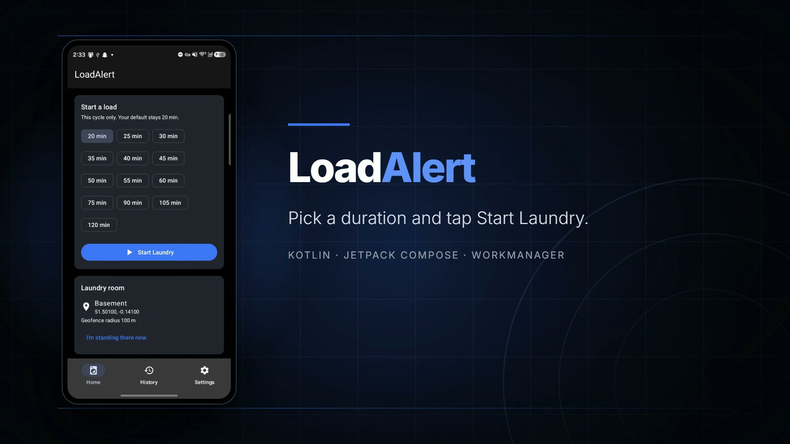
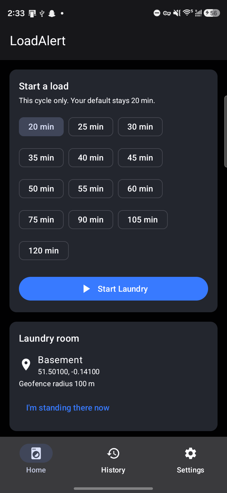
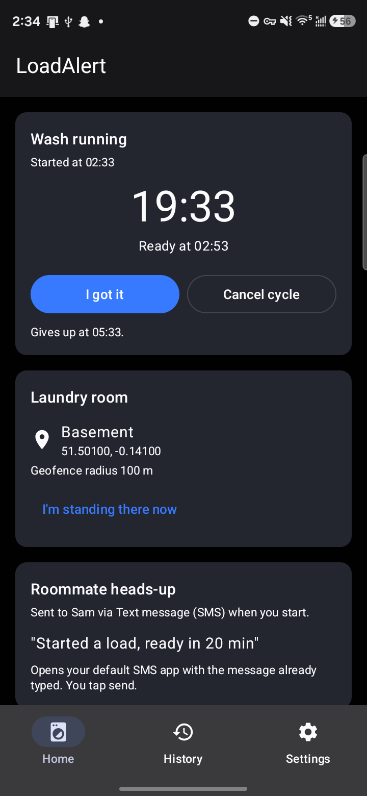
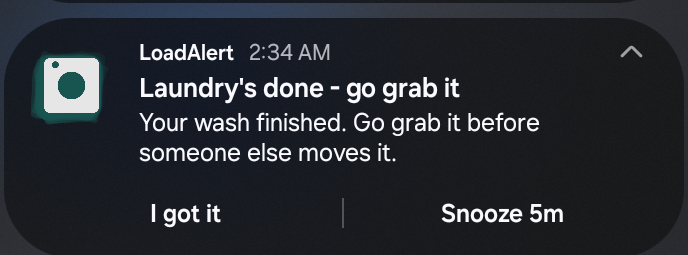
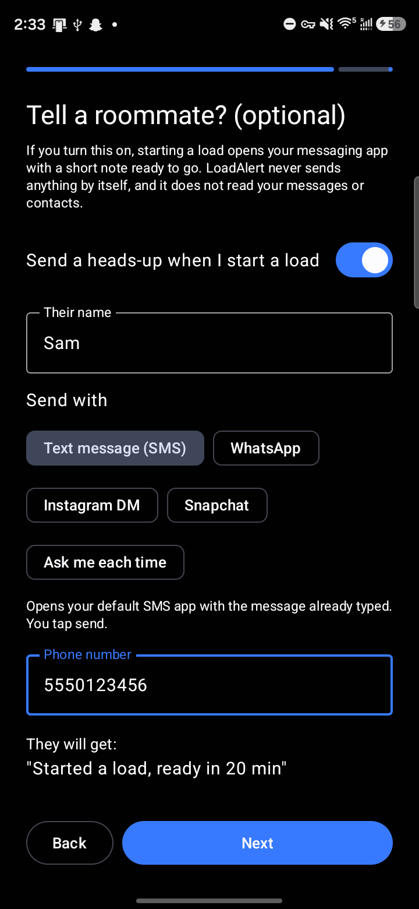
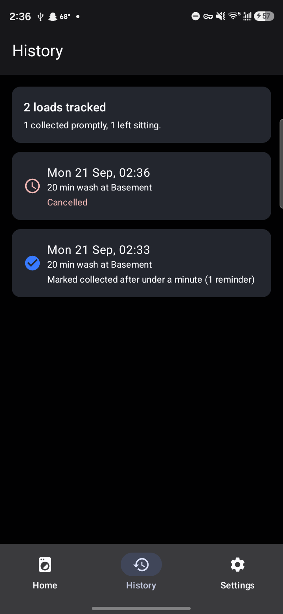
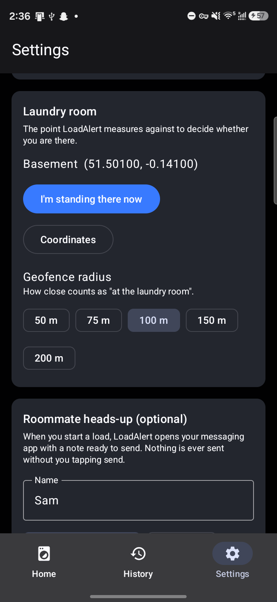

# LoadAlert

[](https://gitlab.com/AlexWeber64/LoadAlert/-/pipelines)

An Android app that reminds you to pick your laundry up out of a shared laundry room.

You start a load, LoadAlert runs the timer in the background, and when the wash finishes it
checks whether you are actually at the laundry room. If you are not, it keeps reminding you,
getting louder the longer you ignore it, until you confirm you have collected the load.

## Demo

A 46-second walkthrough: start a load, the wash running in the background, the reminder
firing, and the cycle recorded in history.

[](docs/demo/loadalert-demo.mp4)

<sub>Click the image to play. Source: <a href="docs/demo/loadalert-demo.mp4">docs/demo/loadalert-demo.mp4</a></sub>

## Screenshots

Real screens from a physical device. The laundry room pin and roommate are demo values.

| Start a load | Wash running | Reminder |
| --- | --- | --- |
|  |  |  |

| Roommate setup | History | Settings |
| --- | --- | --- |
|  |  |  |

## The core flow

1. **Start.** Pick a duration on the home screen (or use the saved default) and tap
   *Start Laundry*. LoadAlert pins the laundry room from the saved setup location, or captures
   the current GPS fix if this is the first load. If a roommate is configured, your messaging
   app opens with *"Started a load, ready in N min"* ready to send.
2. **Wait.** A `WorkManager` job is scheduled for the moment the wash finishes. Nothing needs
   to stay on screen.
3. **Wash finishes.** The laundry-room geofence is registered and a one-shot location check
   runs. If you are already there, the cycle closes silently. If not, you get a high-priority
   *"Laundry's done - go grab it"* notification with an **I got it** action.
4. **Keep checking.** Every *reminder interval* (default 5 min) LoadAlert re-checks. After the
   configured number of ignored checks it escalates: alarm-style sound, longer vibration, and
   optionally a shorter interval.

A cycle ends when any of these happens:

- you tap **I got it** (or the button in the app),
- the geofence sees you **arrive after the wash finished and then leave again**,
- a location check finds you **at the laundry room**,
- the **max cycle time** is reached (default 3 h).

## Project layout

```
app/src/main/java/com/loadalert/
├── LoadAlertApplication.kt     Application; owns the service container
├── di/AppContainer.kt          Hand-rolled service locator (workers/receivers can't take ctor args)
├── data/
│   ├── model/                  LaundrySettings, CycleState, LaundryLocation, MessagingApp, ...
│   ├── settings/               SettingsRepository (Preferences DataStore)
│   ├── cycle/                  CycleStateRepository: the one in-flight cycle (DataStore)
│   └── history/                Room: CycleRecord, DAO, database, HistoryRepository
├── domain/
│   ├── CycleCoordinator.kt      All cycle rules live here; owns the side effects
│   └── CyclePolicy.kt           The pure arithmetic (deadline, interval, escalation)
├── location/                   LocationClient, GeofenceManager, GeofenceBroadcastReceiver, permissions
├── notifications/              NotificationHelper, QuietHoursGate, CycleActionReceiver
├── messaging/                  RoommateMessenger: builds the outgoing Intent
├── work/                       CycleScheduler + LaundryReadyWorker + ReminderCheckWorker
├── widget/                     Glance home-screen widget
└── ui/                         Compose: onboarding, home, history, settings, permissions
```

`CycleCoordinator` is the important file. Workers, the geofence receiver, the notification
action receiver and the UI all call into it, so the rules are written once rather than
re-derived in four processes that each get their own short-lived JVM.

The decisions it makes (when to give up, how long until the next check, whether to escalate)
live in `CyclePolicy`, which takes the clock as a parameter and touches no Android types. That
split is what makes the interesting behaviour unit-testable without an emulator.

## Design notes

**Why one-shot location checks alongside the Geofencing API.** Geofences are the right tool for
"has the user arrived", but transitions can take minutes to be reported and are unreliable over
the span of a single wash cycle. LoadAlert registers the fence when the wash finishes *and*
takes a `FusedLocationProviderClient` fix on every reminder check. The fence provides the
leave-after-arriving confirmation; the one-shot fix provides the short-cycle backstop. An
unknown position is treated as "not there", so LoadAlert over-reminds rather than going quiet.

**Why the fence is registered late.** Before the wash finishes there is nothing to detect, and a
fence that lives for the whole cycle costs battery for no signal.

**Why reminder checks are chained one-shot jobs.** `PeriodicWorkRequest` clamps to a 15-minute
floor; the default reminder interval is 5 minutes. Each check schedules the next, which also
lets escalation shorten the interval mid-cycle.

**Why escalation uses two notification channels.** A channel's importance, sound and vibration
are frozen once Android creates it, so "louder" has to mean "a different channel".

**Quiet hours hold, they do not drop.** A reminder that lands inside the quiet window is
rescheduled for the moment the window closes, and does not count towards the escalation
ladder. Otherwise you would wake up already at maximum urgency.

**Max cycle time** is measured from the start of the cycle, but is never allowed to land less
than 30 minutes after the wash finishes. Otherwise a 2-hour wash with a 1-hour cap would leave
no time to remind you at all.

**Battery optimisation is surfaced, not ignored.** Doze and vendor battery managers can defer
a WorkManager job well past its deadline, which for this app is the difference between working
and not. Settings shows a "Reminder reliability" card whenever the app is still battery
optimised, with a button to the system exemption screen. It disappears once the exemption is
granted. Verified on a Samsung device, where this is especially aggressive.

**Messaging is never automatic.** No mainstream messaging app allows a third party to send on
your behalf, and pretending otherwise would be a lie in the UI. Every path opens the target app
with the send button still to press:

| App | What actually happens |
| --- | --- |
| SMS | `ACTION_SENDTO` on `smsto:` with `sms_body`; recipient and text pre-filled. |
| WhatsApp | `wa.me` deep link; chat opens with the text pre-filled. |
| Snapchat | `ACTION_SEND`; Snapchat's send-to screen opens and you pick the friend. |
| Instagram | Instagram drops text for DMs, so LoadAlert copies the message to the clipboard and opens the share sheet to paste. |
| Ask each time | System share sheet. |

Anything that cannot be resolved falls back to the share sheet rather than failing silently.
The caveat text for each app is shown in onboarding and in Settings.

## Permissions

| Permission | Why | When asked |
| --- | --- | --- |
| `POST_NOTIFICATIONS` (13+) | Reminders are the product. | Onboarding, with rationale |
| `ACCESS_FINE_LOCATION` / `ACCESS_COARSE_LOCATION` | Compare your position with the laundry room. | Onboarding, with rationale |
| `ACCESS_BACKGROUND_LOCATION` (10+) | Checks run while the app is closed. | Separately, after foreground location |

From Android 11 the system refuses to show a runtime dialog for background location, so
LoadAlert explains what "Allow all the time" means and sends you to the app settings page.
Location never leaves the device.

## Build

Requires JDK 17+ and Android SDK platform 37.

```bash
./gradlew :app:assembleDebug     # build the APK
./gradlew :app:testDebugUnitTest # run the JVM unit tests
./gradlew :app:installDebug      # install on a connected device
```

Toolchain: Gradle 9.7.1, Android Gradle Plugin 9.4.1, Kotlin 2.2.10, `compileSdk`/`targetSdk`
37, `minSdk` 26.

Two toolchain notes, both consequences of AGP 9:

- AGP 9 has **built-in Kotlin support**, so `org.jetbrains.kotlin.android` is deliberately
  *not* applied, because AGP rejects it. The Compose compiler plugin and KSP are still applied, and
  their versions are pinned to the KGP that AGP 9.4.1 bundles (2.2.10). Bumping AGP means
  re-checking that pin.
- `android.disallowKotlinSourceSets=false` in `gradle.properties` is required because KSP
  registers its generated sources through the `kotlin.sourceSets` DSL, which AGP 9 rejects by
  default. Without it Room's generated `LoadAlertDatabase_Impl` never reaches the APK, and the
  failure shows up at runtime rather than at build time.

## Testing the cycle without waiting an hour

Don't wait out a real wash. Start a load, then force the scheduled job:

```bash
# find the job id
adb shell dumpsys jobscheduler | grep -oE "systemjobscheduler:u0a[0-9]+/[0-9]+: [a-f0-9]+ #LaundryReadyWorker#"
# run it now
adb shell cmd jobscheduler run -f -n androidx.work.systemjobscheduler com.loadalert <JOB_ID>
```

To exercise the *reminder* path rather than the silent "already there" path, point the laundry
room somewhere you are not (Settings, Coordinates) before starting the load. `adb logcat -s
CycleCoordinator:I GeofenceManager:I` shows each decision the coordinator makes.

Verified on a physical Samsung device (Android 16 / API 36): onboarding, GPS capture, cycle
start, WorkManager scheduling, the "already there" silent finish, the reminder notification with
both actions, "I got it", Room history persistence, and the roommate SMS intent arriving in the
messaging app with the body pre-filled.

Not yet verified on hardware: real geofence enter/exit transitions, which need physical movement
in and out of the radius. The one-shot location check that backstops them is verified.
